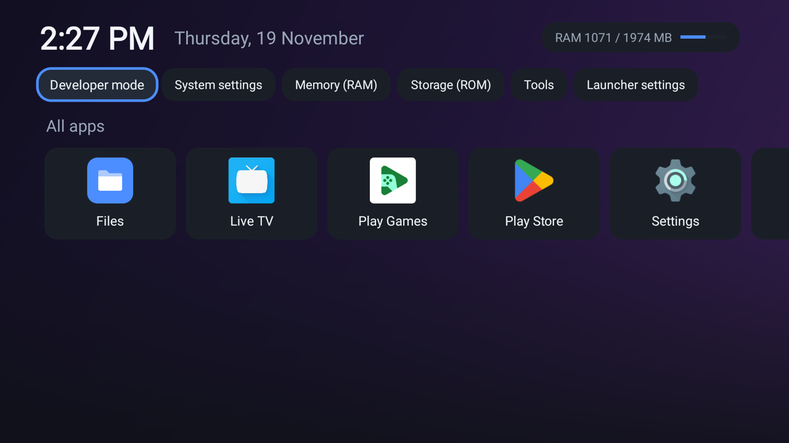
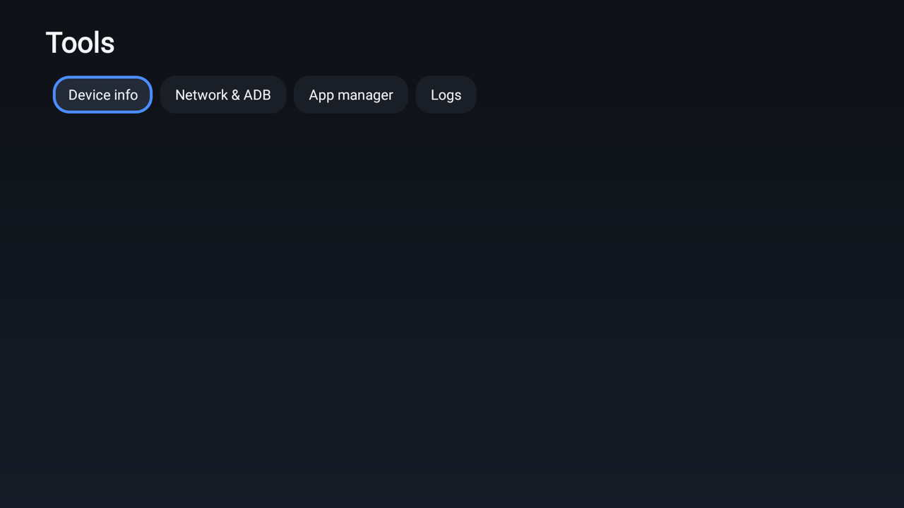
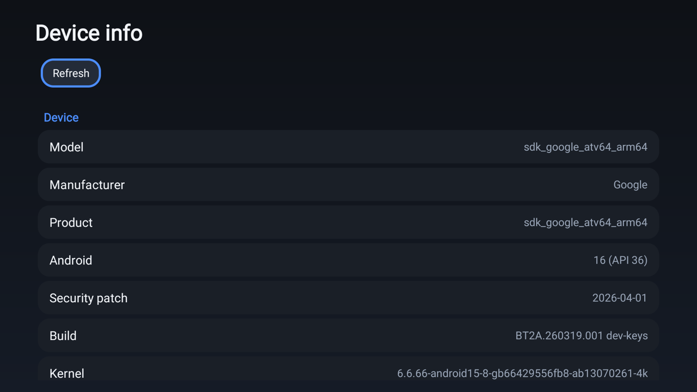
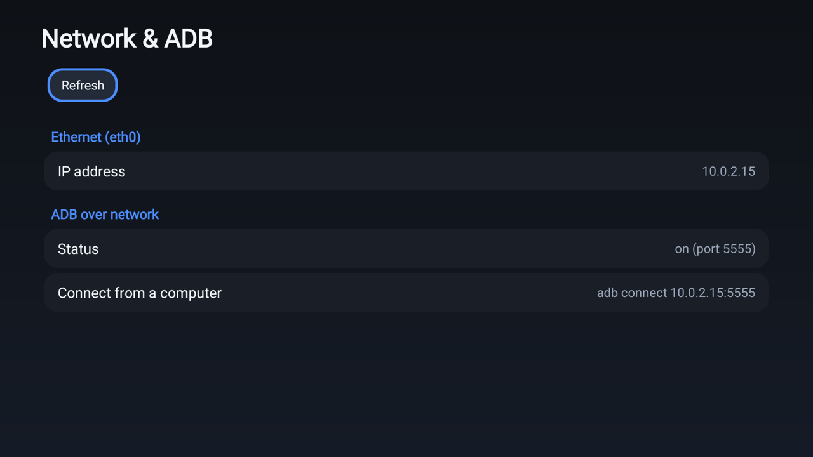
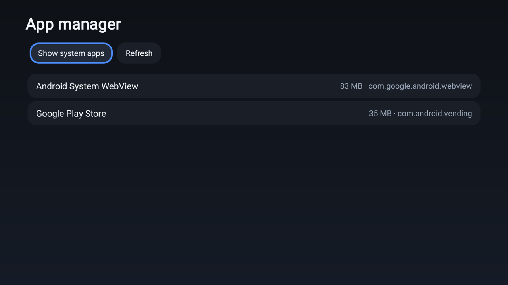
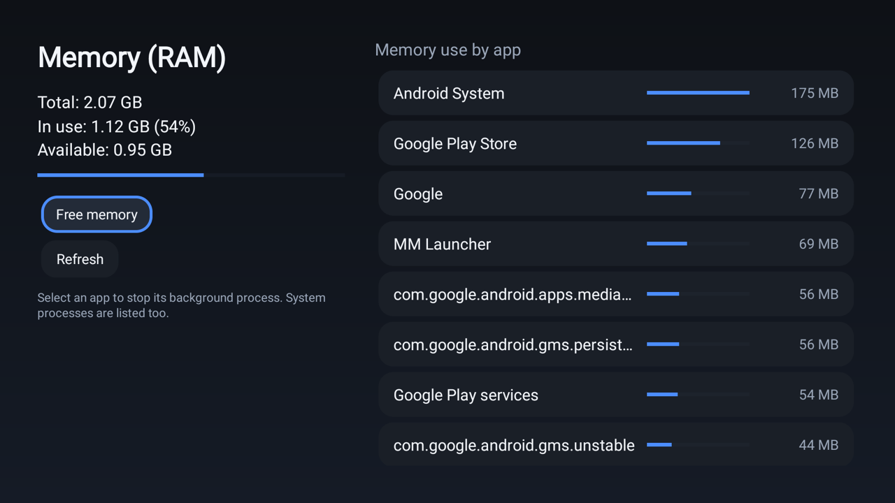
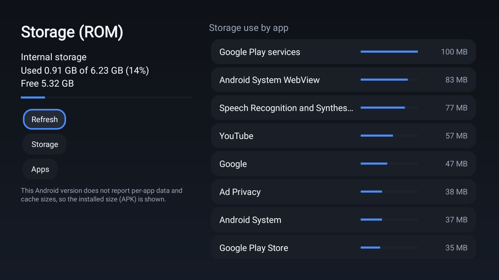
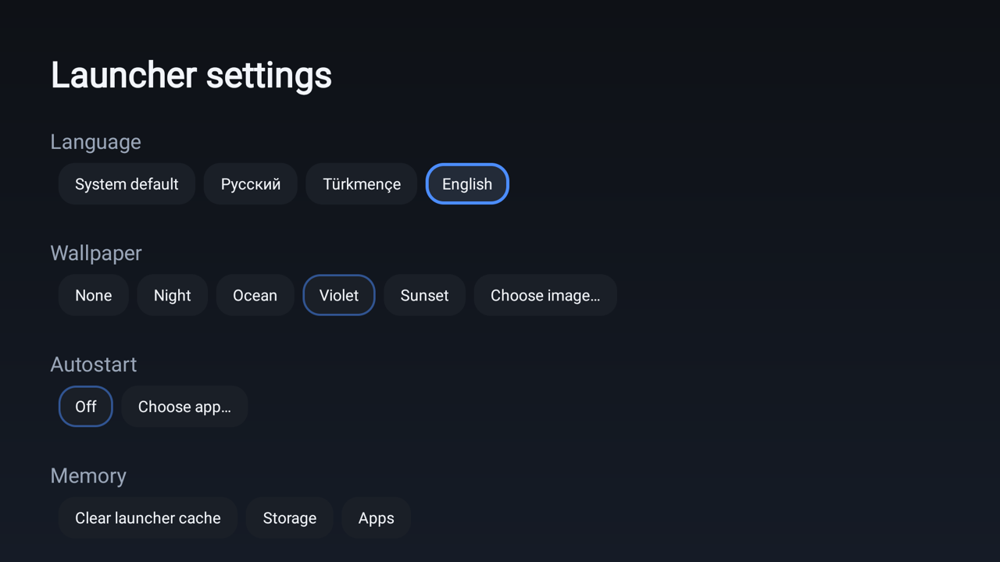

<div align="center">

# MM Launcher

**A free, light home screen for Android TV and Android boxes.**
Plain Kotlin + XML, no Compose, about 0.5 MB APK, easy on RAM.

[**Download the APK**](https://github.com/mammetmyrat/mmlauncher/releases/latest) ·
[Website](https://mammetmyrat.github.io/mmlauncher/) ·
Android 7.0+ · EN / RU / TK



</div>

## Why MM Launcher

- **Light.** Views/XML instead of Compose, almost no dependencies. The home screen stays small in memory, which matters on cheap boxes with 1–2 GB RAM.
- **Made for the remote.** Everything is reachable with the D-pad. Mouse and air-mouse work too.
- **Tools built in.** Developer helpers and system info are one click away, no extra apps needed.
- **Free.** No ads, no account.

## Features

- All apps and favourites (favourites go first), hide and uninstall menu
- Quick access to system settings, HDMI inputs and USB
- Built-in **file manager**
- **Memory (RAM)** and **Storage (ROM)** screens, with per-app numbers through the box's own local ADB
- **Tools:** device info, network and ADB, app manager, logs
- **Developer mode** screen (tap the build 7 times, or enable it with one ADB permission)
- Replace the stock launcher so the **Home** button opens MM Launcher (reversible)
- Wallpapers, autostart of one app, first-run wizard
- Russian, Turkmen and English, switchable inside the app
- Optional update check (SHA-256 verified)

## Screenshots

| Tools | Device info |
|:--:|:--:|
|  |  |
| **Network & ADB** | **App manager** |
|  |  |
| **Memory (RAM)** | **Storage (ROM)** |
|  |  |
| **Launcher settings** | |
|  | |

## Install

1. Download `mm-launcher-*.apk` from the [latest release](https://github.com/mammetmyrat/mmlauncher/releases/latest).
2. Put it on the TV or box (USB drive, or `adb install mm-launcher-0.1.0.apk`) and open it. Allow installs from that source if asked.
3. Start **MM Launcher** and follow the first-run wizard.

### Make the Home button open MM Launcher

On many TVs and on Google TV the stock launcher is pinned to the Home button. Two ways:

- **In the app:** Launcher settings → *Replace system launcher (ADB)*. It needs ADB over network once (`adb tcpip 5555` from a computer) and your approval on the TV. *Restore system launcher* undoes it.
- **From a computer:**
  ```bash
  adb connect TV_IP:5555
  adb shell pm disable-user --user 0 com.google.android.tvlauncher
  adb shell cmd role add-role-holder --user 0 android.app.role.HOME com.mmlauncher.tv 0
  ```
  To undo: `adb shell pm enable com.google.android.tvlauncher`.

> Some firmwares hide Developer options completely. Then ADB can only be enabled by the vendor or over USB. See the in-app Developer mode screen for hints.

## Build

```bash
./gradlew assembleDebug        # debug APK
./gradlew testDebugUnitTest    # unit tests
./gradlew assembleRelease      # needs keystore.properties for a signed APK
```

Package `com.mmlauncher.tv`, minSdk 24, targetSdk 34.

## Project docs

- [`ARCHITECTURE.md`](ARCHITECTURE.md): layers (domain / data / presentation), MVI, how to add a screen
- [`RELEASE.md`](RELEASE.md): signing and building a release
- [`ACCEPTANCE.md`](ACCEPTANCE.md): what is verified and what is not
- `scripts/release.sh`, `scripts/install-on-boxes.sh`: release and seller tools
- `docs/`: GitHub Pages site (download page, seller guide, privacy policy)

## Author

Made by [Mammet](https://github.com/mammetmyrat).
